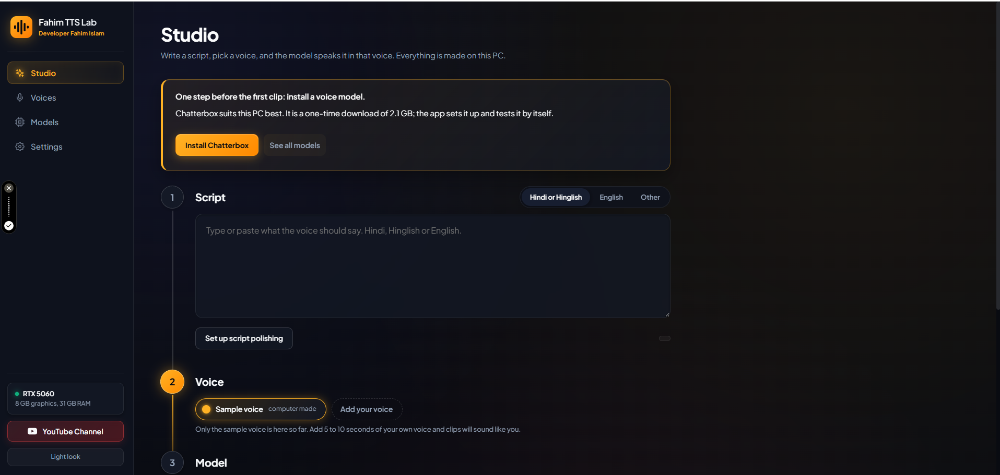
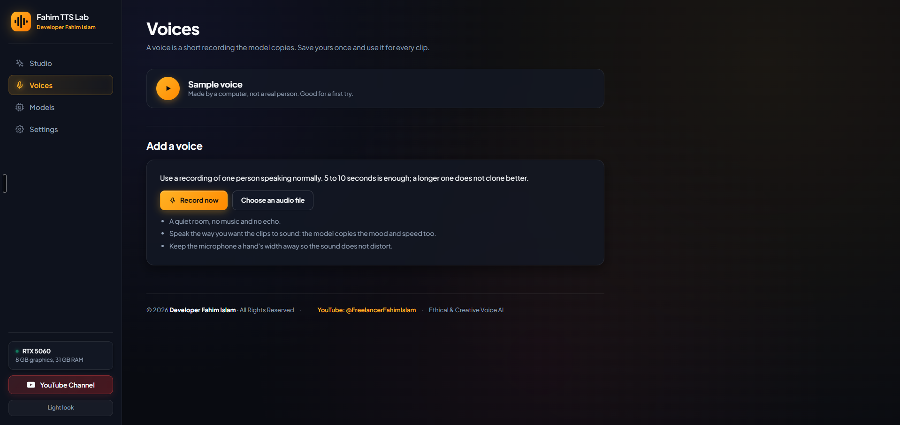
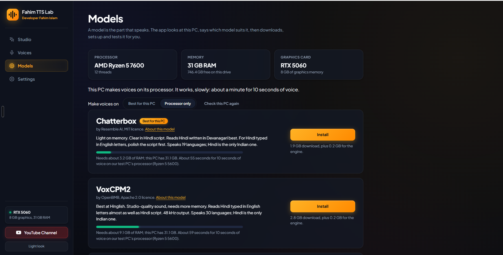
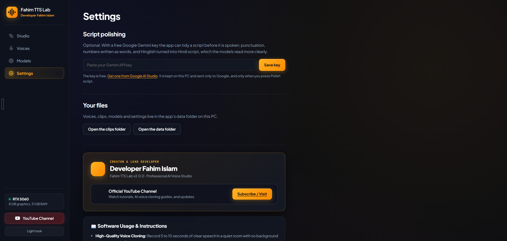

# Fahim TTS Lab

[](https://github.com/fahimislam7409-boop/FahimIslamTTSLab)
[](LICENSE)
[](https://github.com/fahimislam7409-boop/FahimIslamTTSLab)
[](https://www.youtube.com/@FreelancerFahimIslam/videos)

**Developed by Developer Fahim Islam**  
Official YouTube Channel: [**Freelancer Fahim Islam**](https://www.youtube.com/@FreelancerFahimIslam/videos) (Tutorials, AI Voice Demos & Updates)

---



**Fahim TTS Lab** is an advanced, high-performance, completely offline AI Voice Cloning and Text-to-Speech (TTS) Studio. It allows you to clone any voice with just 5 to 10 seconds of audio and generate crystal-clear, realistic speech in multiple languages directly on your own computer.

Everything runs **100% locally on your PC**—your voice samples, scripts, and generated audio clips remain private and secure.

---

## 📸 Studio Screenshots & Preview

| Studio Interface | Voices Management |
|:---:|:---:|
|  |  |
| *AI Script Prompting & Voice Generation* | *Clone & Manage Custom Voice Profiles* |

| Hardware & Models | Developer Hub & Settings |
|:---:|:---:|
|  |  |
| *Automated Hardware Detection & Engine Setup* | *Developer Profile, YouTube Channel & Legal Disclaimer* |

---

## 🌟 Key Features

- 🎙️ **Fast Voice Cloning:** Create a reusable voice profile from just 5–10 seconds of clear speech (record directly in the app or upload a WAV file).
- 🔒 **100% Local & Offline Privacy:** All neural inference and voice generation happen on your own hardware. Nothing leaves your PC.
- ⚡ **Multi-Hardware Support:**
  - **NVIDIA GPUs:** Blazing-fast CUDA hardware acceleration.
  - **AMD & Intel GPUs:** Smooth acceleration via Vulkan.
  - **CPU Mode:** High-efficiency processor mode for PCs without dedicated graphics cards.
- 🧠 **Three State-of-the-Art Neural Engines:**
  - **VoxCPM2:** Studio-grade 48 kHz audio with exceptional clarity in English and Hinglish.
  - **Chatterbox:** Lightweight and memory-efficient voice cloning.
  - **OmniVoice:** Multilingual engine supporting 600+ world languages, including Bengali, Hindi, Tamil, Telugu, Marathi, and more.
- ✍️ **Smart Script Polishing (Optional):** Integrates with free Google Gemini API keys to polish pronunciation, numbers, punctuation, and script conversions.
- 🚀 **Zero-Configuration Launcher:** Simply double-click `Start Fahim TTS Lab.bat`. The app manages its own isolated environment with no manual Python setup required.
- 🎨 **Modern Dark Studio UI:** Sleek, high-contrast Obsidian & Midnight Studio interface with real-time waveform visualization and hardware monitoring.

---

## 🚀 Quick Start Guide

### Step 1: Download the Repository
- **[Download ZIP](https://github.com/fahimislam7409-boop/FahimIslamTTSLab/archive/refs/heads/main.zip)** and extract it to a short folder path (e.g., `C:\FahimTTSLab`).  
- *Or clone using Git:*
  ```bash
  git clone https://github.com/fahimislam7409-boop/FahimIslamTTSLab.git
  ```

### Step 2: Launch the Studio
- Double-click **`Start Fahim TTS Lab.bat`**.
- On first start, it automatically downloads an isolated, private Python runtime (11 MB) and opens the Studio in your browser (`http://127.0.0.1:7870`).

### Step 3: Install Model & Generate
1. The app automatically detects your PC hardware and suggests the best model.
2. Click **Install** to set up the engine.
3. Record or upload your reference voice.
4. Enter your script and click **Make the voice**!

---

## 💻 Hardware Requirements

| Hardware Configuration | Recommended Model | Generation Speed (10s Audio) |
|:---|:---|:---|
| **NVIDIA GPU (8 GB+ VRAM)** | VoxCPM2 | ~5 seconds |
| **NVIDIA GPU (4 to 6 GB VRAM)** | Chatterbox | ~5 seconds |
| **AMD / Intel GPU (4 GB+ VRAM)** | Chatterbox (Vulkan) | ~6 seconds |
| **Processor Only (16 GB RAM)** | Chatterbox / VoxCPM2 | ~60 seconds |
| **Processor Only (8 GB RAM)** | Chatterbox | ~60 seconds |

---

## 🌐 Supported Languages

- **Bengali, Hindi, Urdu, Tamil, Telugu, Marathi, Gujarati, Punjabi, Kannada, Malayalam, Odia, Nepali** (via OmniVoice)
- **English, Spanish, French, German, Japanese, Chinese, Russian, Arabic, Portuguese, Korean, Italian** and 600+ additional languages across the models.

---

## 🛠️ Project Structure

```
FahimIslamTTSLab/
├── Start Fahim TTS Lab.bat    # 1-Click launcher script
├── app/                       # Core server, hardware detection, engine & speech logic
│   ├── brand.py               # Branding, versioning & creator metadata
│   ├── engines.py             # Model execution & hardware dispatch
│   ├── omni_engine.py         # Multilingual engine pipeline
│   ├── speech.py              # Audio synthesis & clip processing
│   └── server.py              # Local API server
├── docs/                      # Official Fahim TTS Lab Studio screenshots
│   ├── studio.png             # Studio interface preview
│   ├── voices.png             # Voice profiles preview
│   ├── models.png             # Hardware telemetry preview
│   └── settings.png           # Developer hub & disclaimer preview
├── web/                       # Modern Obsidian Studio frontend (HTML, CSS, JS)
│   ├── app.css                # Premium studio styles & responsive layout
│   ├── app.js                 # Signal chain, waveform renderer & UI logic
│   └── index.html             # Studio shell & navigation
├── tests/                     # Unit test suite
├── LICENSE                    # MIT License
├── THIRD_PARTY.md             # Open-source model licenses & attribution
└── README.md                  # Project documentation
```

---

## ⚖️ Ethics, Fair Use & License

- **Developer Attribution:** Developed, customized, and maintained by **Developer Fahim Islam**.
- **License:** This application is licensed under the [MIT License](LICENSE).
- **Ethical Voice Cloning Notice:** This software is designed for personal, creative, and authorized production workflows. Clone only your own voice or voices you have express authorization to reproduce. Unauthorized impersonation, voice spoofing, or deceptive use is strictly prohibited.
- **Model Credits:** Neural engine binaries and model weights are downloaded directly from their respective creators (ShugoAI `audio.cpp`, Resemble AI `Chatterbox`, OpenBMB `VoxCPM2`, and k2-fsa `OmniVoice`). See [THIRD_PARTY.md](THIRD_PARTY.md) for full licensing details.

---

### 📺 Connect & Support
For video tutorials, feature demos, and updates, visit:  
**YouTube Channel:** [youtube.com/@FreelancerFahimIslam](https://www.youtube.com/@FreelancerFahimIslam/videos)
